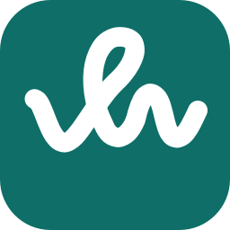
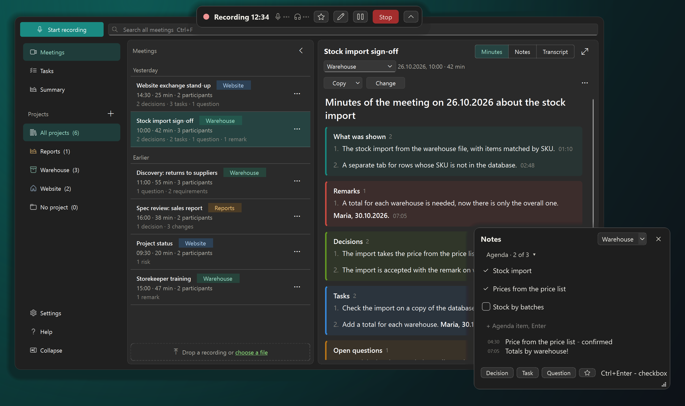
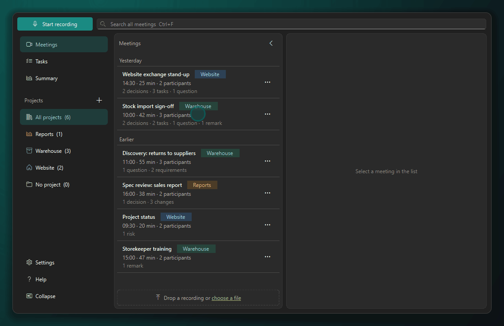
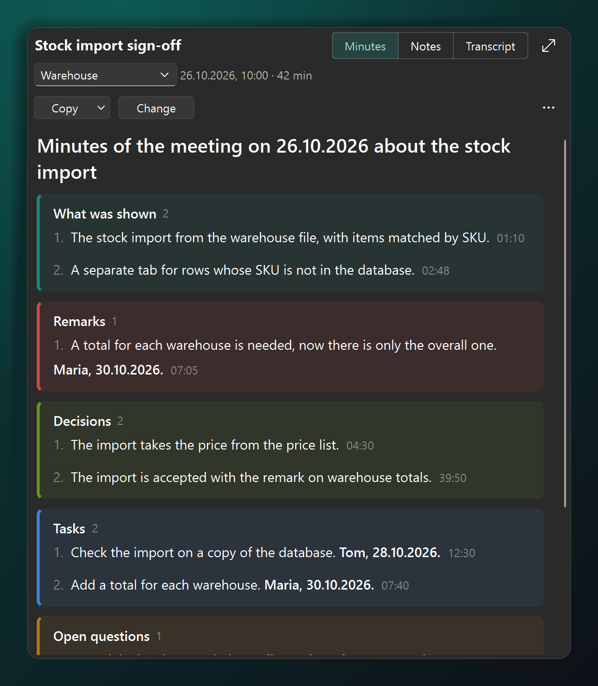
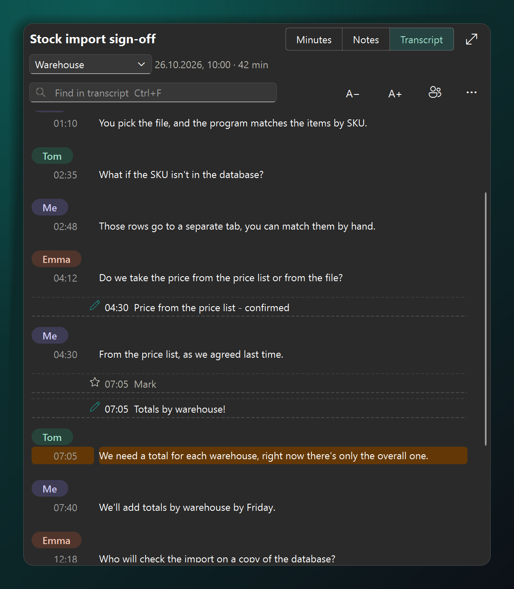
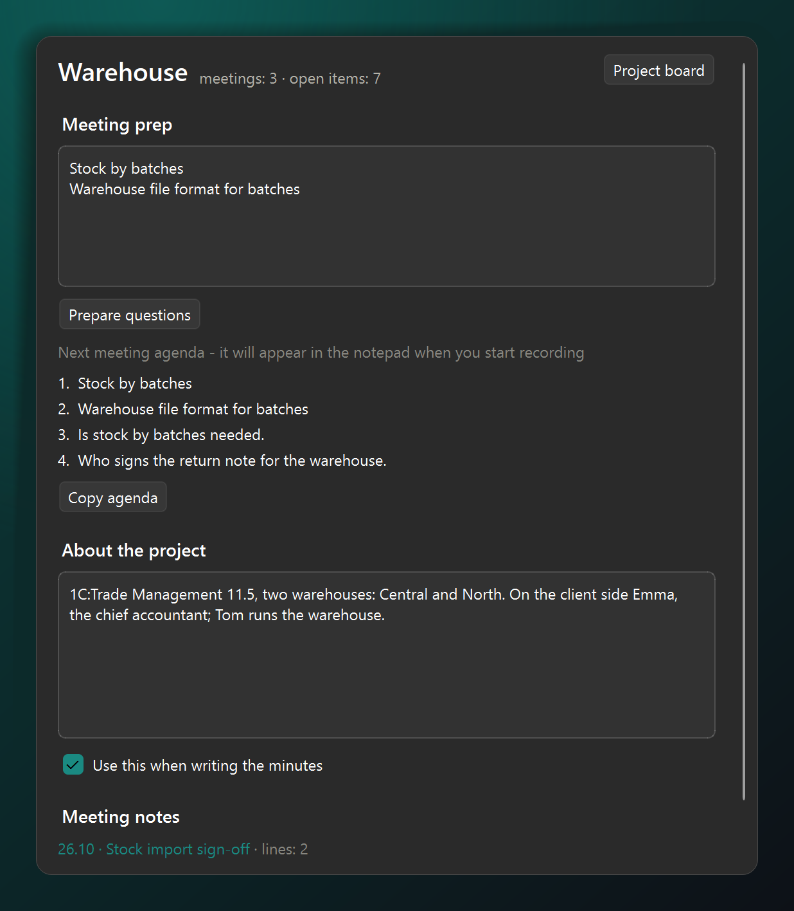
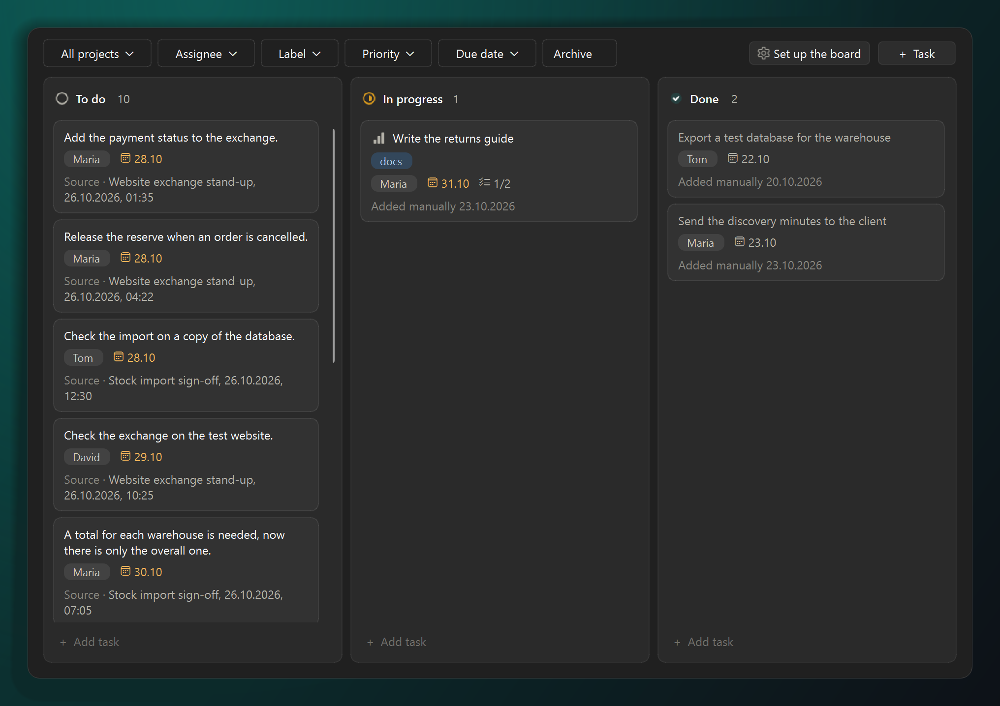
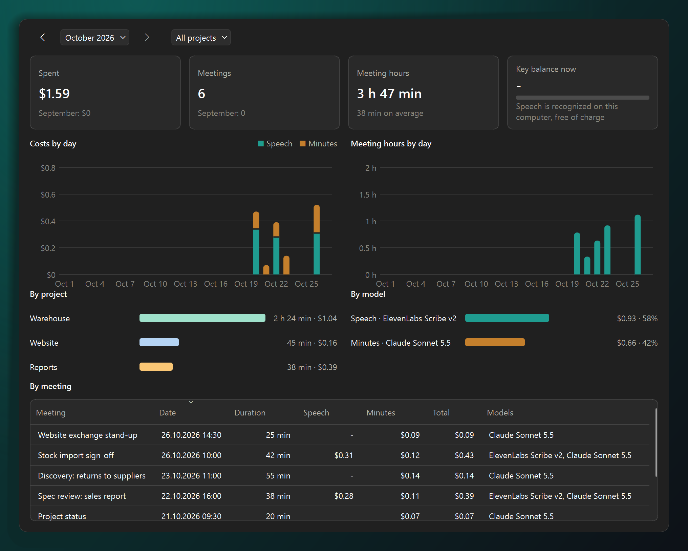

<p align="center">
  
</p>

<h1 align="center">QG Knotes</h1>

<p align="center">
  <b>No bot joins the call. You still get the minutes.</b><br>
  QG Knotes records your microphone and your computer's sound, recognizes speech on your PC<br>
  and writes the minutes: what was decided, who does what, what is still open.
</p>

<p align="center">
  <a href="https://github.com/JBskaro/qg-knotes/releases/latest"></a>
</p>

<p align="center">
  
  
  
</p>

<p align="center">
  <a href="#get-started">Get started</a> ·
  <a href="#what-runs-where">What runs where</a> ·
  <a href="#questions">Questions</a> ·
  <a href="README.ru.md">Русский</a>
</p>

<p align="center">
  <a href="https://github.com/JBskaro/qg-knotes/releases/latest"></a>
</p>

The call is over, the client is waiting for a summary, and you remember half of it. With QG Knotes you press "Start
recording", talk, and press "Stop". QG Knotes transcribes the conversation, and "Write minutes" gives you a draft a
minute or two later: decisions, tasks with an owner and a due date, open questions and the date of the next meeting.
Every item carries the minute it was said.

It knows meeting types like discovery and spec review, and the email for the client is copied without timestamps and
private notes. It runs on Windows 10 and 11.

<p align="center">
  <br>
  <sub>15 seconds: the minutes, a click on a time in them, the project page, the task board</sub>
</p>

## Why QG Knotes

- **No bot in the call.** Nobody asks what that "Notetaker" in the participant list is. QG Knotes records your
  microphone and whatever plays on your computer, so Zoom, Teams, Telemost and browser meetings all work. When a
  meeting app turns on your microphone, QG Knotes offers to record.
- **Speech is recognized on your PC.** GigaAM v3 for Russian or Whisper, offline once the model is downloaded, at no
  cost. The cloud (OpenRouter, OpenAI, your own server) is there only if you want it.
- **"We never agreed to that" takes one click to check.** Every decision and task carries the minute it was said.
  Click it and hear how it went.
- **Your notes stay yours.** Share your screen with the client: the notepad and the recording bar stay out of the
  picture. Each note lands in the transcript at its minute.
- **Tasks survive between meetings.** Tasks from all the minutes land on one board, and open questions go into the
  next meeting's agenda by themselves.
- **No sign-up, no subscription.** Free and open source. Meetings are plain files in "Documents\QG Knotes".

## Get started

1. Download one of the two from [Releases](https://github.com/JBskaro/qg-knotes/releases/latest); the program is the
   same.
   - The installer `QG-Knotes-<version>-setup.exe` installs for you only, without administrator rights, into
     `%LOCALAPPDATA%\Programs\QG Knotes`, adds a Start menu shortcut (a desktop one if you tick it) and an entry in
     Settings > Apps > Installed apps, where the program is uninstalled. A new version installs over the old one; a
     running program is closed first. Uninstalling keeps the settings, keys, models and recordings.
   - The portable `QG-Knotes-<version>.zip`: unpack it into any folder and run `QG Knotes.exe`.

   The app is not code-signed yet, so the installer does not avoid the warning: if Windows shows "Windows protected
   your PC" when the installer or the unpacked app first starts, click "More info" and "Run anyway".
2. The first-run wizard checks the microphone and the other participants' sound, downloads the speech model and makes
   a 10-second test recording.
3. In a meeting, press "Start recording" or Ctrl+Alt+R. After you stop, QG Knotes offers to transcribe the recording,
   and "Write minutes" makes the minutes.

## What it does

### Click a task and hear who promised it

The minutes come in colored blocks: what was shown, remarks, decisions, tasks, open questions, the next meeting. The
sections depend on the type of meeting: a demo gets its own, a spec review gets its own. "Copy" gives a clean email for
the client, without timestamps and your private notes.



### See who said what

Your lines are labeled "Me", and you name the others once. Notes from the notepad sit between the phrases at their
minute. Fix a recognition typo with a double-click on the phrase.



### The next agenda builds itself

Open a project: QG Knotes has already put the open questions, the decisions waiting for confirmation and what you did
not get to last time into the agenda. When you start recording a meeting of that project, the agenda comes to the
notepad.



### Every task from every meeting on one board

Tasks, remarks and questions come from the minutes by themselves. Drag the cards between "To do", "In progress" and
"Done": each one remembers the meeting and the minute it came from.



### What each meeting cost

If you recognize speech in the cloud, the summary shows the spending by day, project and model. Recognition on your PC
costs nothing.



### And also

- **Minutes and transcript as a file.** PDF or Word from the Copy button. The client version has no timestamps and no
  private notes.
- **Personal data stays out of the cloud.** Phone numbers, e-mails, tax and passport numbers, accounts and addresses
  reach a cloud model as labels, and the minutes get the real values back.
- **Questions for the first meeting.** "Prepare questions" on the project page: the model suggests what to ask the
  client at this kind of meeting and what to request in advance.
- **Transcript during the meeting.** An option in Settings: the notepad shows the latest phrases with their minute and
  an "Ask" field, say, for what the client promised to send.
- **Own columns and labels on the board.** "Set up the board" above any board: columns of each project ("Waiting
  for the client", "In review" or anything else, drag to reorder, rename in place, choose what each counts as) and
  labels with colors, in one window.
- **Reminder by the calendar.** When a calendar meeting starts, the app asks "Meeting started, record?".

## What runs where

| What | Where |
|---|---|
| Recording the sound and the screen | Your computer |
| Speech recognition | Your computer (GigaAM v3 or Whisper). In the cloud only if you pick a service |
| The minutes | The language model you chose: OpenRouter or OpenAI, Ollama or LM Studio on your own computer, your AI assistant |
| Meetings, transcripts, minutes | The "Documents\QG Knotes" folder |
| Service keys | Windows Credential Manager |
| Claude, ChatGPT, Cursor (MCP) | Read the meetings from your computer; there is no server on the network |

## Questions

<details>
<summary><b>How much does it cost?</b></summary>

QG Knotes is free, and so is recognition on your PC. The minutes are written by a language model: through OpenRouter
you pay for its work and the summary shows what each meeting cost; Ollama or LM Studio on your own computer cost
nothing.
</details>

<details>
<summary><b>Will the others know they are being recorded?</b></summary>

No bot joins the call, so nothing shows up in the list of participants. Tell them anyway: you may record a
conversation you take part in, and it is polite to say so.
</details>

<details>
<summary><b>Do I need the internet?</b></summary>

Not for recognition on your PC; the model is downloaded once. The minutes need a connection to the model you chose,
unless it runs on your computer.
</details>

<details>
<summary><b>Which meetings can it record?</b></summary>

Any meeting whose sound goes through your computer: Zoom, Teams, Telemost, browser meetings. A finished video or audio
file works too: drop it into the meeting list.
</details>

<details>
<summary><b>What language are the minutes in?</b></summary>

The language of the meeting: a Russian conversation gets Russian minutes, an English one gets English minutes. The
interface is English or Russian. For English meetings pick Whisper or a cloud service: GigaAM v3 is built for Russian
speech.
</details>

<details>
<summary><b>How is QG Knotes different from other meeting apps?</b></summary>

There are many similar apps, most of them for Mac only or with a bot that joins the call. QG Knotes runs on Windows
without a bot, recognizes Russian speech with GigaAM right on your PC and keeps the work going between meetings: a
task board built from the minutes, the next meeting's agenda, MCP for Claude, ChatGPT and Cursor.
</details>

<details>
<summary><b>Mac or Linux?</b></summary>

Windows 10 and 11 only, for now.
</details>

## All features

- **Two tracks.** The microphone (you) and the computer's sound (the other participants) are recognized separately
  and joined by time.
- **Recognition on this computer**, the default for a new installation: the sherpa-onnx engine with GigaAM v3 (with
  punctuation) or Whisper large-v3-turbo, or any sherpa-onnx model from Hugging Face. Speakers are told apart with
  pyannote segmentation and WeSpeaker; Silero VAD finds the speech. On Windows, built-in GigaAM tries DirectML on a
  compatible DirectX 12 GPU and falls back to the CPU. Voice detection and speaker separation still use the CPU.
- **Cloud recognition and minutes** through any service with an OpenAI-compatible API: OpenRouter (ElevenLabs Scribe
  v2 for speech, Claude Sonnet 5.5 for minutes), Nexara, OpenAI, Ollama, LM Studio or your own server.
- **Screen recording** together with the sound: the meeting window, the monitor with it or a chosen monitor. The
  recording bar, the notepad and the program's messages stay out of the video and of your screen sharing.
- **Notes during the meeting**: a notepad on top of the other windows with the minute of each line and the agenda of
  the project; the minutes are built around your notes.
- **Calendar**: with an ICS link from Outlook, Google or Yandex a recording gets the meeting's title, participants and
  project, and at the start of a calendar meeting the app asks whether to record.
- **Vocabulary** for names and terms the recognition gets wrong.
- **Help** by topic with search, and an English or Russian interface.

The minutes are written in the language of the meeting, Russian or English, whatever the interface language.

## AI assistant (MCP)

Claude Desktop and other MCP clients see the meetings on this computer; there is no server on the network. In
Settings, section "App", "Copy config for Claude" copies the config: paste it into an empty
`claude_desktop_config.json` as a whole, or move only the `qg-knotes` entry into its existing `mcpServers`, and restart
Claude.

The skill in [skills/qg-knotes](skills/qg-knotes/SKILL.md) tells the assistant how to use the tools: what to read
first, what never goes to the client, what to change only on request. [skills/README.md](skills/README.md) shows how to
connect the server and add the skill in Claude Desktop, Claude Code, the ChatGPT desktop app and Codex, and Cursor.
ChatGPT on the web cannot reach a program on your computer.

- Reading: `list_meetings`, `search_meetings`, `get_protocol`, `get_transcript`, `get_meeting_notes`,
  `get_project_notes`, `list_open_items`, `get_costs`.
- Changes, only when the user asks: `set_task_status`, `update_task`, `add_task`, `compose_protocol`,
  `update_protocol`, `set_speaker_names`, `set_meeting_info`; minutes by the assistant itself with
  `get_protocol_task` and `save_protocol`, and the ready prompt `compose_protocol`.
- Starting a recording, recognition and deleting meetings are not available over MCP.

The exchange is a short implementation of the protocol in `knotes/mcp.py`: the program needs only initialize,
tools/list, tools/call and prompts, and the official library would bring a web server with 25 more packages.

## Command line

```
"QG Knotes.exe" --autostart                  start without a window, only the icon in the notification area
"QG Knotes.exe" --record                     start or stop a recording (starts the program if needed)
"QG Knotes.exe" --quit                       close the running program
"QG Knotes.exe" --settings                   open the settings
"QG Knotes.exe" --transcribe <folder|file>   transcribe without windows; exit code and transcript file
"QG Knotes.exe" --mcp                        MCP server for Claude and other AI assistants (standard input and output)
```

The Russian options of earlier versions (`--запись`, `--настройки`, `--расшифровать`) still work.

## Development

```bat
py -3.13 -m venv .venv
.venv\Scripts\python.exe -m pip install --require-hashes -r requirements.lock
.venv\Scripts\python.exe -m knotes
.venv\Scripts\python.exe check.py
.venv\Scripts\python.exe build.py
```

`check.py` is the quality guard (key scan, ruff, dead code, duplicated code, tests, coverage of the logic at least
80%). To build the Windows distribution, download the wheel artifact from the
[DirectML workflow](.github/workflows/directml-wheel.yml) and install it into `.venv` with
`.venv\Scripts\python.exe -m pip install --no-deps --force-reinstall <wheel-file>` after the pinned requirements. The workflow builds
the wheel from a fixed sherpa-onnx commit and includes the DirectML runtime. `build.py` rejects a CPU-only wheel and
builds the portable version into `dist\`, and
the installer from `installer/qg-knotes.iss` when [Inno Setup](https://jrsoftware.org/isdl.php) 6.6 or newer is
installed (without it, only the zip). The
pictures on this page come from the real windows on made-up meetings: `docs/screenshots/make_screenshots.py`. See
[CONTRIBUTING.md](CONTRIBUTING.md) for the rules.

## License

QG Knotes is free software under the [GNU General Public License version 3](LICENSE). The components it bundles and
the models it downloads keep their own licenses: see [THIRD_PARTY_NOTICES.md](THIRD_PARTY_NOTICES.md).

The license covers the code, not the name: "QG Knotes", "Uzelok" ("Узелок") and the icon identify this project. A
modified version distributed to others needs its own name and icon.
