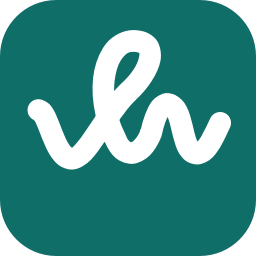
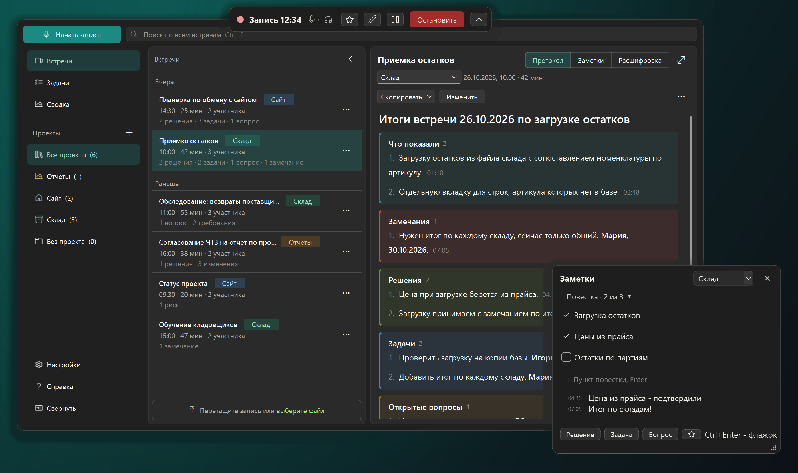
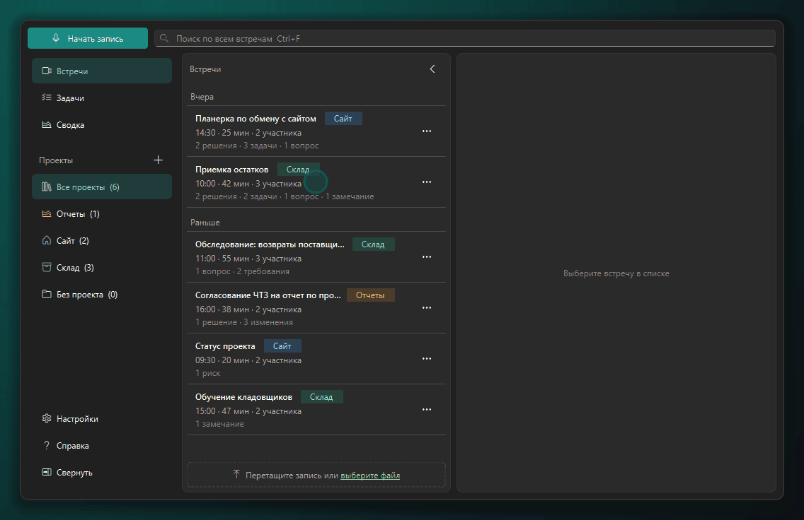
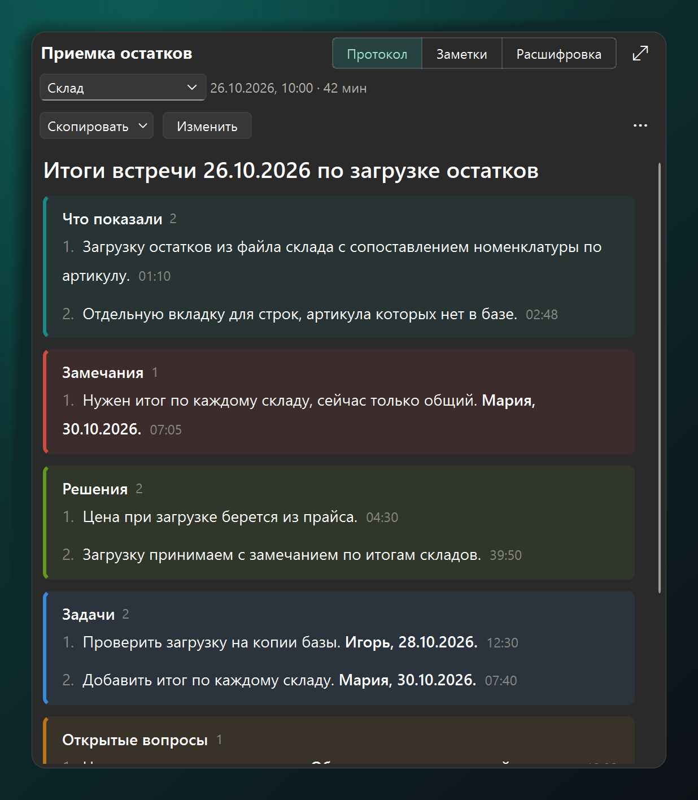
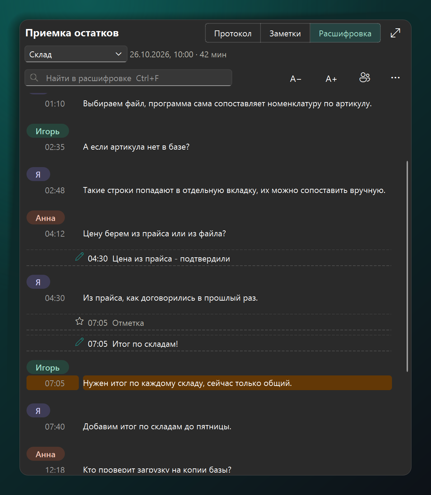
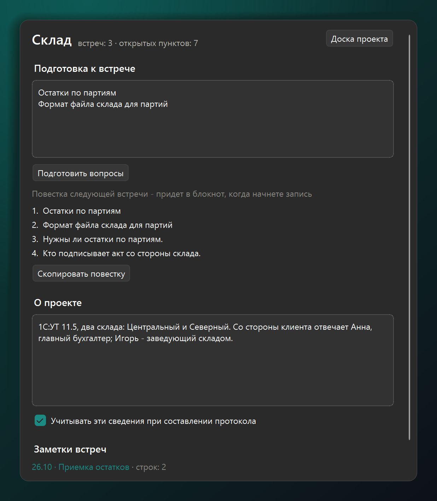
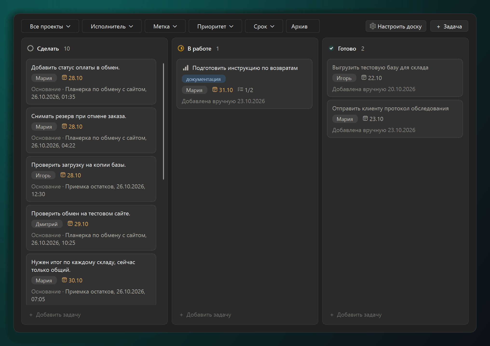
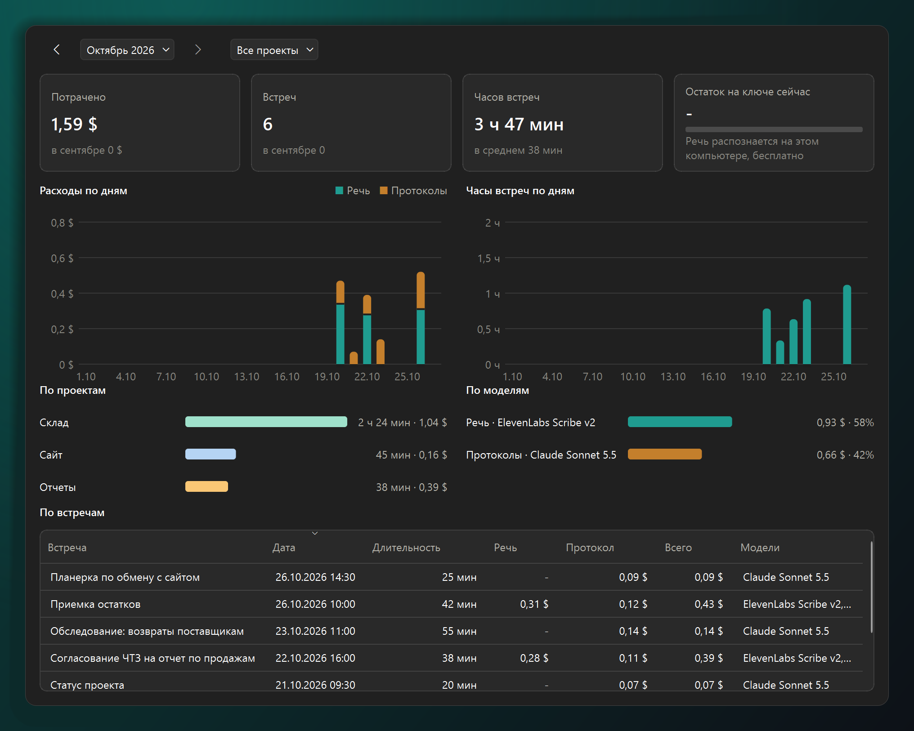

<p align="center">
  
</p>

<h1 align="center">Узелок</h1>

<p align="center">
  <b>Бот на встречу не придет. Протокол все равно будет.</b><br>
  Узелок записывает ваш микрофон и звук компьютера, распознает речь прямо на компьютере<br>
  и пишет протокол: что решили, кто что делает, что осталось открытым.
</p>

<p align="center">
  <a href="https://github.com/JBskaro/qg-knotes/releases/latest"></a>
</p>

<p align="center">
  
  
  
</p>

<p align="center">
  <a href="#как-начать">Как начать</a> ·
  <a href="#где-что-происходит">Где что происходит</a> ·
  <a href="#вопросы">Вопросы</a> ·
  <a href="README.md">English</a>
</p>

<p align="center">
  <a href="https://github.com/JBskaro/qg-knotes/releases/latest"></a>
</p>

Встреча закончилась, клиент ждет итоги, а в голове осталась половина. С Узелком так: нажали «Начать запись»,
поговорили, нажали «Остановить». Узелок распознает разговор, а по кнопке «Составить протокол» через минуту-две дает
черновик: решения, задачи с исполнителем и сроком, открытые вопросы и дату следующей встречи. У каждого пункта стоит
минута, когда это прозвучало.

В нем есть виды встреч вроде обследования и согласования ЧТЗ, а письмо клиенту копируется без меток времени и
заметок для себя. Работает на Windows 10 и 11.

<p align="center">
  <br>
  <sub>15 секунд: протокол, щелчок по времени в нем, страница проекта, доска задач</sub>
</p>

## Почему Узелок

- **Бота во встрече нет.** Никто не спросит, что за «Notetaker» в списке участников. Узелок пишет ваш микрофон и звук
  компьютера, поэтому подходят Zoom, Teams, Телемост и встреча в браузере. Включили микрофон в программе для встреч,
  и Узелок сам предложит записать.
- **Русскую речь распознает на вашем компьютере.** Модель GigaAM v3 хорошо понимает русский и работает без интернета.
  Это бесплатно. Облако (OpenRouter, OpenAI, свой сервер) подключаете, только если сами захотите.
- **«Мы такого не обещали» проверяется одним щелчком.** У каждого решения и задачи стоит минута записи. Щелкнули, и
  слышно, как это было сказано.
- **Заметки видите только вы.** Показываете клиенту экран, а блокнот и строка записи на показ не попадают. Каждая
  заметка встает в расшифровку на свою минуту.
- **Задачи не теряются между встречами.** Задачи из всех протоколов собираются на одну доску, а открытые вопросы сами
  попадают в повестку следующей встречи.
- **Без регистрации и подписки.** Программа бесплатная, код открыт. Встречи лежат обычными файлами в папке
  «Документы\QG Knotes».

## Как начать

1. Скачайте в [выпусках](https://github.com/JBskaro/qg-knotes/releases/latest) любой из двух вариантов, программа одна
   и та же.
   - Установщик `QG-Knotes-<версия>-setup.exe` ставит программу только для вас, без прав администратора, в
     `%LOCALAPPDATA%\Programs\QG Knotes`, добавляет ярлык в меню «Пуск» (по галочке и на рабочий стол) и строку в
     «Параметры» > «Приложения» > «Установленные приложения», там же программа удаляется. Новая версия ставится
     поверх прежней, запущенная программа перед этим закрывается. Удаление не трогает настройки, ключи, модели и
     записи.
   - Переносной `QG-Knotes-<версия>.zip`: распакуйте в любую папку и запустите `QG Knotes.exe`.

   Подписи кода пока нет, и установщик предупреждение не убирает: если при первом запуске установщика или
   распакованной программы Windows покажет «Windows защитила ваш компьютер», нажмите «Подробнее» и «Выполнить в любом
   случае».
2. Мастер первого запуска проверит микрофон и звук собеседников, скачает модель распознавания и сделает пробную
   запись на 10 секунд.
3. На встрече нажмите «Начать запись» или Ctrl+Alt+R. После остановки Узелок предложит распознать запись, а
   протокол составит по кнопке «Составить протокол».

## Что умеет

### Щелкните по задаче и услышите, кто ее пообещал

Протокол разбит на цветные блоки: что показали, замечания, решения, задачи, открытые вопросы, следующая встреча.
Разделы зависят от вида встречи: у показа доработки свои, у согласования ЧТЗ свои. «Скопировать» дает чистое письмо
клиенту, без меток времени и заметок для себя.



### Видно, кто что сказал

Ваши реплики подписаны «Я», собеседников подпишете по имени один раз. Заметки из блокнота стоят среди фраз на своей
минуте. Опечатку распознавания исправите двойным щелчком по фразе.



### Повестку следующей встречи собирать не нужно

Откройте проект: Узелок уже сложил в повестку открытые вопросы, решения на подтверждении и то, до чего в прошлый раз
не дошли. Когда начнете запись встречи этого проекта, повестка придет в блокнот.



### Все задачи со всех встреч на одной доске

Задачи, замечания и вопросы приходят из протоколов сами. Перетаскивайте карточки между «Сделать», «В работе» и
«Готово»: каждая помнит встречу и минуту, откуда взялась.



### Сколько стоила каждая встреча

Если распознаете в облаке, сводка покажет траты по дням, проектам и моделям. Распознавание на компьютере ничего не
стоит.



### Что еще

- **Протокол и расшифровка файлом.** PDF или Word по кнопке «Скопировать». Для клиента без меток времени и заметок для
  себя.
- **Личные данные не уходят в облако.** Телефоны, e-mail, ИНН, СНИЛС, паспорта, счета и адреса облачная модель видит
  метками, а в протокол возвращаются настоящие значения.
- **Вопросы к первой встрече.** На странице проекта «Подготовить вопросы»: модель предложит, что спросить у клиента
  на встрече такого вида и что запросить заранее.
- **Расшифровка прямо во время встречи.** Включается в настройках: в блокноте последние фразы с минутой и поле
  «Спросить», например что клиент обещал прислать.
- **Свои колонки и метки на доске.** Кнопка «Настроить доску» над любой доской: колонки каждого проекта («Ждет
  ответа клиента», «На проверке» и любые другие, порядок перетаскиванием, название прямо в строке, вид колонки) и
  метки с цветами, в одном окне.
- **Напоминание по календарю.** Когда начинается встреча из календаря, программа спрашивает «Встреча началась,
  записать?».

## Где что происходит

| Что | Где |
|---|---|
| Запись звука и экрана | На вашем компьютере |
| Распознавание речи | На вашем компьютере (GigaAM v3 или Whisper). В облаке, только если выбрали сервис |
| Протокол | Языковая модель, которую выбрали вы: OpenRouter или OpenAI, Ollama или LM Studio на своем компьютере, ваш помощник ИИ |
| Встречи, расшифровки, протоколы | Папка «Документы\QG Knotes» |
| Ключи от сервисов | Диспетчер учетных данных Windows |
| Claude, ChatGPT, Cursor (MCP) | Читают встречи с вашего компьютера, сервера в сети нет |

## Вопросы

<details>
<summary><b>Сколько это стоит?</b></summary>

Узелок бесплатный. Распознавание на компьютере бесплатно. Протокол пишет языковая модель: через OpenRouter вы платите
за ее работу, и сводка покажет, сколько ушло на каждую встречу; Ollama или LM Studio на своем компьютере ничего не
стоят.
</details>

<details>
<summary><b>Узнают ли собеседники, что идет запись?</b></summary>

Бот во встречу не заходит, поэтому в списке участников ничего не появится. Но сказать о записи все равно стоит:
записывать разговор, в котором вы участвуете, можно, а предупредить собеседников просто вежливо.
</details>

<details>
<summary><b>Нужен ли интернет?</b></summary>

Для распознавания на компьютере нет, модель скачивается один раз. Протоколу нужна связь с выбранной моделью, если она
не стоит у вас на компьютере.
</details>

<details>
<summary><b>Какие встречи можно записать?</b></summary>

Любые, звук которых идет через компьютер: Zoom, Teams, Телемост, встречи в браузере. Готовое видео или звук тоже
подойдет, его достаточно перетащить в список встреч.
</details>

<details>
<summary><b>На каком языке протокол?</b></summary>

На языке встречи. Говорили по-русски, протокол будет на русском, по-английски, на английском. Интерфейс программы
русский или английский, на выбор. Для английских встреч выберите Whisper или облачное распознавание: GigaAM v3
рассчитана на русскую речь.
</details>

<details>
<summary><b>Чем Узелок отличается от других программ для встреч?</b></summary>

Похожих программ много, большинство из них только для Mac или зовут бота во встречу. Узелок работает на Windows без
бота, распознает русскую речь моделью GigaAM прямо на компьютере и ведет работу между встречами: доска задач из
протоколов, повестка следующей встречи, MCP для Claude, ChatGPT и Cursor.
</details>

<details>
<summary><b>А для Mac или Linux?</b></summary>

Пока только Windows 10 и 11.
</details>

## Подробно

<details>
<summary><b>Как устроено: дорожки, распознавание, запись экрана, ключи</b></summary>

- Пишутся две дорожки: микрофон (вы) и звук компьютера (собеседники); каждая распознается отдельно и склеивается
  по времени. Ваши реплики подписаны «Я», собеседники - «Собеседник 1, 2…».
- Подключения одинаковы для распознавания речи и протоколов: заготовка, адрес, ключ и модель. Заготовки описаны в
  `knotes/providers.json`: для речи OpenRouter (проверен, ElevenLabs Scribe v2), Nexara, OpenAI и свой сервер; для
  протоколов OpenRouter (проверен, Claude Sonnet 5.5), OpenAI, Ollama и LM Studio. Адрес - до `/v1`, как у OpenAI,
  окончание запроса программа добавляет сама; подойдет любой сервис с API как у OpenAI. «Проверить» спрашивает у
  сервиса, принимает ли он ключ, и показывает число моделей. Модель выбирается из списка или вписывается вручную.
- Запись экрана (настройки, «Записи», «Записывать экран»): вместе со звуком пишется область окна встречи, монитор
  с ним или выбранный монитор, в одном из трех качеств. ffmpeg снимает кусками, пауза закрывает кусок; после записи куски склеиваются с дорожками
  звука в `видео.mp4` (`knotes/screen.py`). Во встрече над расшифровкой - кадр места и кадры при проигрывании
  фразы (`knotes/ui/video_view.py`), «Открыть видео» в меню. Строка записи, блокнот и сообщения программы в запись не попадают, если
  включено «Скрывать строку при показе экрана»; видео удаляется вместе со звуком. Аппаратное сжатие (Media Foundation), без него - libx264.
- Распознавание на этом компьютере (заготовка «На этом компьютере», у новой установки выбрана сразу): звук
  никуда не уходит и денег не стоит. Движок
  sherpa-onnx работает отдельным процессом самой программы (`--local-engine`, `knotes/local_engine.py`). Модели не зашиты в
  программу. Каталог `knotes/models.json` - проверенные: GigaAM v3 (по умолчанию, со знаками препинания), Whisper
  large-v3-turbo; служебные Silero VAD и разметка говорящих pyannote + WeSpeaker. В сборке для Windows GigaAM пробует
  DirectML на совместимой с DirectX 12 видеокарте и возвращается к процессору, если режим недоступен. Поиск речи и
  разметка говорящих остаются на процессоре. В окне «Выбор модели» (кнопка
  «Выбрать модель…» в настройках, рядом «Скачать» для выбранной) кроме них - все модели sherpa-onnx с Hugging Face с поиском и выбором языка (потоковые и с
  некоммерческой лицензией скрыты) и своя модель по ссылке; берутся только файлы ONNX и настройки, без кода. Качаются
  на закрепленной ревизии Hugging Face или с GitHub, с докачкой и сверкой sha256 (`knotes/models.py`), лежат в
  `%LOCALAPPDATA%\QG Knotes\модели`, удаляются там же. Служебные модели качаются сами перед первым распознаванием.
  «Различать собеседников» включает разметку говорящих, «Указать зеркало» - адрес вместо huggingface.co.
- Словарь в настройках: как слово пишется правильно и как его может услышать распознавание; новые расшифровки
  исправляются сами, окончания сохраняются; готовую поправит только повторное распознавание.
- Ключ API хранится в диспетчере учетных данных Windows под сервером адреса (у речи и протоколов на одном сервере
  он общий) или берется из переменной `OPENROUTER_API_KEY`; настройки - в `%APPDATA%\QG Knotes\настройки.json`,
  журнал - в `%LOCALAPPDATA%\QG Knotes\журнал.log`.

</details>

<details>
<summary><b>Как пользоваться: каждая часть программы</b></summary>

Распакуйте `QG-Knotes-<версия>.zip` в любую папку и запустите `QG Knotes.exe`. Подписи кода пока нет, поэтому Windows
при первом запуске покажет «Windows защитила ваш компьютер» - нажмите «Подробнее» и «Выполнить в любом случае».

- При первом запуске открывается настройка в три шага (`knotes/ui/setup_wizard.py`): полоски громкости
  микрофона и звука собеседников (кнопка «Проверить» играет короткий сигнал), выбор распознавания (на этом
  компьютере - модель качается сразу, или сервис с ключом и проверкой) и пробная запись на 10 секунд с ее
  текстом. Потом подсказки окна: запись, значок у часов и, если настройку пропустили и распознавать нечем,
  настройки; при первом открытии настроек - свои подсказки (заготовка, ключ или модель, протоколы). Все
  показывается один раз, снова - в «Справке»: «Показать подсказки» и «Проверить звук и распознавание»
  (`knotes/ui/tour.py`).
- Программа живет у часов: щелчок по значку открывает список встреч, правая кнопка - меню. Слева в окне колонка
  разделов, как панель навигации в программах Windows: сверху «Встречи», «Задачи», «Сводка», ниже проекты, внизу
  «Настройки», «Справка», «Свернуть». Раздел открывается справа на месте списка и встречи, колонка остается на
  месте (Alt+← - к встречам). Сообщения появляются полупрозрачной плашкой сверху экрана.
- «Начать запись» (или горячая клавиша, по умолчанию Ctrl+Alt+R, меняется в настройках). Наверху экрана появится
  полупрозрачная строка записи: время, громкость микрофона и собеседников, отметка «★», блокнот «✎», пауза,
  «Остановить» и «свернуть» (останется «● 12:34»). В демонстрацию экрана строка не попадает, пока включено «Скрывать строку при показе экрана» (по умолчанию включено). Если микрофон или
  собеседников не слышно, строка предупредит. Гарнитуру подключите до начала записи.
- Блокнот встречи (карандаш на строке, Ctrl+Alt+N или «Заметки встречи» в меню у часов) - как у Granola: окно
  поверх остальных, в демонстрацию экрана не попадает. У строки слева минута записи, когда ее начали; «Решение»,
  «Задача», «Вопрос» начинают строку с подсказки модели; Ctrl+Enter - флажок, «# » - заголовок. Сверху повестка
  проекта флажками, в шапке - проект встречи. Esc прячет блокнот и возвращает фокус в программу встречи.
  Заметки лежат в `заметки.md` папки встречи; модель строит протокол вокруг них, пункт из заметки отмечен «✎».
- Микрофон и вывод звука по умолчанию - как выбрано в Windows; какие пишутся, видно при наведении на значки
  громкости на строке. Другие можно выбрать в настройках (раздел «Встречи»), если программа встречи пользуется не ими.
- Когда Zoom, Teams, Телемост или браузер держат микрофон дольше 3 секунд, программа спросит
  «Похоже, началась встреча. Записать?». Один раз за встречу: если выключить и включить звук, это та же встреча;
  новая - после 5 минут без микрофона.
- После остановки программа спросит «Отправить запись на расшифровку?» (в настройках: спрашивать, отправлять сразу
  или только записывать). Когда расшифровка готова, придет сообщение; щелчок открывает `расшифровка.md`.
- В колонке разделов проекты, как папки в почте: «Все проекты», проекты с числом встреч, «Без проекта». Встречу
  можно перетащить на проект; «+» у заголовка «Проекты» - новый проект, переименовать и удалить - правой кнопкой.
  Поиск и «Сводка» - внутри выбранного, на доске проект отбирает задачи.
- Окно встреч - три колонки, как у похожих программ: разделы с проектами, встречи по дням и открытая встреча. Щелчок
  по встрече открывает ее справа (отправка на распознавание - только кнопкой «Распознать · цена»). Границы колонок
  двигаются мышью; «Свернуть» (Ctrl+1) оставляет от колонки разделов полоску значков с подписью при наведении, список
  скрывается кнопкой «‹» в его шапке (Ctrl+2), F11 или кнопка во встрече - читать на всю ширину, «Встречи» слева
  возвращает все. Ширины, свернутое и скрытое запоминаются. У встречи с протоколом под строкой его итог
  («3 решения · 5 задач · 2 вопроса»), пометка - только если встреча не готова («Не отправлена», «Ошибка»); во время
  распознавания - «2 из 3, осталось около 1 мин». «…» у встречи: переименовать (F2), проект, распознать заново,
  открыть папку, удалить в корзину (Del). Поиск сверху ищет по всем расшифровкам.
- Готовое видео встречи перетащите в список, нажмите «выберите файл» внизу или просто положите в папку записей.
- Встреча: название, проект, дата и длительность и три вкладки на всю ширину - «Протокол» (открыт сразу),
  «Заметки» (блокнот встречи, щелчок по минуте - это место расшифровки) и «Расшифровка» (Ctrl+3 переключает
  протокол и расшифровку, Ctrl+F - поиск в расшифровке) с фразами по участникам и заметками среди них. Кнопка с
  людьми - участники: имена вместо «Собеседник 1», доля речи, отметки и заметки. Щелчок по времени фразы
  проигрывает это место, двойной щелчок по фразе открывает ее для правки, правой кнопкой - заметка к фразе.
- Протокол своим помощником ИИ, рядом с обычным подключением: Claude Desktop или другой клиент MCP
  берет задание `get_protocol_task` (та же инструкция и расшифровка) и сохраняет протокол `save_protocol`;
  в меню клиента готовая просьба `compose_protocol`, во встрече «попросить своего помощника ИИ» под кнопкой
  «Составить протокол» (или «…» у готового протокола) копирует просьбу.
- Протокол: «Составить протокол» отправляет расшифровку языковой модели (по умолчанию
  Claude Sonnet 5.5 через OpenRouter, тот же ключ; или Ollama, LM Studio, любой сервис с API как у OpenAI) по
  инструкции `knotes/minutes_prompt.md`. Черновик `протокол.md` лежит в папке встречи: решения, задачи, открытые
  вопросы, раздел «Для аналитика» (клиенту не идет), метки времени - ссылки на места расшифровки. В окне разделы -
  блоками со своим оттенком, у задач и вопросов «кто и когда» полужирным; имена всегда полные («Александр», а не
  «Саша»). «Изменить» - правка, «Скопировать» - письмо или для базы знаний, без меток и раздела «Для аналитика». Подключение,
  ваше имя вместо «Я» и своя инструкция - раздел «Протоколы».
- Вид встречи (рядом с «Составить протокол»; «Составить заново» предлагает выбрать снова) задает разделы
  протокола: рабочая встреча (решения, задачи, вопросы), обследование (как сейчас, что нужно), показ доработки
  (что показали, замечания), согласование ЧТЗ (изменения в ЧТЗ), статус проекта (сделано, в работе, риски),
  обучение (что показали, вопросы пользователей), внутренняя встреча (без приветствия клиенту). Разделы и виды -
  данные в `knotes/meeting_kinds.json`: как писать пункт, что в раздел идет, оттенок блока, идет ли пункт на доску.
  Вид по умолчанию для проекта - правой кнопкой по проекту, «Протокол по умолчанию». Решение, которое еще надо
  подтвердить, заканчивается фразой «Предварительно, кто подтвердит» и попадает на доску.
- «Сводка» (раздел слева или меню у часов): отборы одной строкой - период «‹ Октябрь 2026 ›»
  (этот и прошлый месяц, 3 месяца, год, все время, свои даты; стрелки листают такие же периоды) и проект. Под ними
  все считается за выбранное: потрачено (речь и протоколы), встречи, часы, расходы и часы встреч по дням,
  неделям или месяцам (по длине периода; столбик расходов делится на речь и протоколы, при наведении - модели и
  доли), проекты и модели, таблица по встречам (речь, протокол, всего, модели; двойной щелчок открывает встречу);
  остаток на ключе OpenRouter - на сейчас. Цены и модели есть только здесь, во встрече и в списке их нет.
  Деньги считаются по журналу трат `.узелок/траты.jsonl` в папке записей: каждое распознавание (каждый
  оплаченный кусок) и каждый протокол, в том числе повторные, - отдельная строка в день оплаты; удаленная встреча
  свои траты не уносит. Журнал начинается с цен, уже сохраненных у встреч. «Потрачено» за этот месяц и за все время
  (по всем проектам) - как в OpenRouter, сколько ушло с ключа; что потрачено не на встречи программы (проверки,
  другие программы на том же ключе), - строкой «Вне встреч» в разбивках и таблице, чтобы все сходилось. По проекту
  и за прошлые периоды OpenRouter не считает - там траты по встречам; если у OpenRouter меньше (новый ключ), тоже.
- Проекту можно задать цвет и значок (правая кнопка по проекту слева): они видны в панели, у встреч в списке и в
  сводке.
- Доска задач (раздел «Задачи» слева, «Задачи» в меню у часов, «Доска проекта» в меню проекта) - как у Linear:
  «Сделать | В работе | Готово» из задач, замечаний, открытых вопросов и решений на подтверждении всех
  протоколов и своих задач. Щелчок по карточке - панель справа: текст, описание, исполнитель, срок (сегодня,
  завтра, через неделю, календарь), метки с цветами, приоритет, чек-лист; сохраняется само, протокол не меняется
  (правки пунктов протокола хранятся отдельно по ключу пункта). Перетаскивание между колонками и внутри колонки,
  правой кнопкой - быстрые действия, внизу колонки «+ Добавить задачу», Enter открывает карточку, Delete - в архив.
  Отборы: проект, исполнитель, метка, приоритет, срок, архив; поиск по задачам - в верхней строке окна (Ctrl+F),
  найденное подсвечено в карточках. У карточки основание - встреча, дата и минута, щелчок открывает расшифровку на
  этом месте. Хранится в `.узелок/задачи.json` в папке записей.
- Настройки доски - кнопка «Настроить доску» над любой доской, и над доской всех проектов тоже. Вкладка «Колонки»:
  проект, порядок перетаскиванием, название прямо в строке, вид («Сделать», «В работе», «Готово»), удаление с
  выбором, куда перенести карточки; последнюю колонку вида удалить нельзя. Название правится и на доске проекта,
  двойным щелчком. На доске всех проектов три основные колонки. Вкладка «Метки»: название в строке, цвет щелчком по
  кружку, сколько карточек с меткой, удаление снимает метку со всех карточек.
- Страница проекта (щелчок по проекту слева, справа от списка): «Подготовка к встрече» - ваши вопросы и темы, из
  них, вопросов в «О проекте», не обсужденного в прошлый раз и открытых вопросов доски собирается повестка
  («Скопировать повестку» - текстом участникам); она приходит в блокнот, обсужденное после встречи уходит из
  списка. «О проекте» - постоянные сведения, по галочке идут модели. «Заметки встреч» - лента заметок встреч
  проекта. Хранится в `.узелок/проекты.json`.
- Календарь (настройки, «Встречи», ссылка ICS из Outlook, Google или Яндекса; хранится в хранилище Windows):
  при начале записи встреча получает название и участников из календаря, а проект - как у прошлой встречи с тем
  же названием. В начале встречи из календаря сверху появляется «Встреча началась, записать?» (если включено
  «Предлагать запись»); календарь перечитывается раз в 15 минут, так что перенесенная встреча напомнит о себе в
  новое время. Новый Outlook не дает программам календарь на компьютере, поэтому нужна ссылка. «Проверить» рядом
  с полем открывает календарь и показывает, сколько встреч на неделе и какая ближайшая.
- Язык интерфейса - русский или английский (настройки, «Программа»; по умолчанию как в Windows). Меняется после
  перезапуска: под выбором появляется «Перезапустить сейчас» (во время записи и распознавания программа не
  перезапускается). Перевод - в `knotes/translations/en/*.json`, полноту проверяет тест; протокол пишется на языке встречи
  (`knotes/minutes_languages.json`).
- Настройки разбиты по разделам слева; что делает настройка - в подсказке при наведении на ее название. Кнопки
  «Сохранить» нет, как советует Microsoft для настроек Windows: изменение применяется сразу, текстовое поле после
  записи показывает «✓ Сохранено», а уход из настроек записывает и недописанное поле. «Справка» - раздел
  слева и пункт меню у часов.
- Если программа закрылась посреди записи, при следующем запуске записанное соберется, дальше - как после обычной записи.

</details>

## Командная строка

```
"QG Knotes.exe" --autostart                  запуск без окна, только значок у часов
"QG Knotes.exe" --record                     начать или остановить запись (запустит программу, если она не запущена)
"QG Knotes.exe" --quit                       закрыть запущенную программу
"QG Knotes.exe" --settings                   открыть настройки
"QG Knotes.exe" --transcribe <папка|файл>    расшифровать без окон; итог - код выхода и расшифровка.md
"QG Knotes.exe" --mcp                        сервер MCP для Claude и других помощников ИИ (ввод и вывод)
```

Прежние русские команды (`--запись`, `--настройки`, `--расшифровать`) тоже работают.

## Помощник ИИ (MCP)

Claude Desktop и другие клиенты MCP видят встречи с этого компьютера, сервера в сети нет. Подключение: настройки,
раздел «Программа», «Скопировать настройку для Claude». Пустой `claude_desktop_config.json` заменить скопированным
целиком, а если в нем уже есть `mcpServers`, перенести туда только запись `qg-knotes`, и перезапустить Claude.
Встреча обозначается именем своей папки, даты - `ГГГГ-ММ-ДД`.

Скилл [skills/qg-knotes](skills/qg-knotes/SKILL.md) учит помощника пользоваться этими инструментами: что читать
сначала, что не уходит клиенту, что менять только по просьбе. Как подключить сервер и добавить скилл:

- Claude Desktop: сервер - как выше; скилл - папку `qg-knotes` упаковать в zip (сама папка в корне архива) и
  загрузить в настройках Claude, «Capabilities», «Skills», «Upload skill».
- Claude Code: `claude mcp add --scope user qg-knotes -- "<путь>\QG Knotes.exe" --mcp`, папку скилла положить в
  `%USERPROFILE%\.claude\skills\`.
- ChatGPT (настольное приложение) и Codex: «Settings», «MCP servers», «Add server», «STDIO», команда - путь к
  `QG Knotes.exe`, аргумент `--mcp` (то же в `%USERPROFILE%\.codex\config.toml`); папку скилла - в
  `%USERPROFILE%\.agents\skills\`. ChatGPT в браузере до программы на компьютере не достает.
- Cursor: сервер в `%USERPROFILE%\.cursor\mcp.json` с `"type": "stdio"`, папку скилла - в
  `%USERPROFILE%\.cursor\skills\` (Cursor читает и `.agents\skills`, и `.claude\skills`).

Подробно и с примерами настроек: [skills/README.md](skills/README.md).

- Заметки: `get_meeting_notes` (блокнот встречи: повестка и заметки с минутами), `get_project_notes` (сведения о
  проекте и подготовка к следующей встрече: вопросы аналитика и собранная повестка).
- Чтение: `list_meetings` (встречи по проекту и датам), `search_meetings` (поиск по расшифровкам с отрывками),
  `get_protocol` (полный, для письма или для базы знаний), `get_transcript` (целиком, кусок по времени или реплики
  одного участника), `list_open_items` (доска задач: кто, срок, метки, приоритет, состояние, основание),
  `get_costs` (расходы, как в сводке).
- Правки, только по просьбе пользователя: `set_task_status`, `update_task` и `add_task` (доска),
  `compose_protocol` (вид встречи `kind`, платно, около 0,15-0,2 $), `update_protocol` (прежний текст - в
  `протокол.прежний.md`), `set_speaker_names`, `set_meeting_info`.
- Запуск записи, распознавание и удаление встреч через MCP недоступны.

Протокол обмена - свой короткий (`knotes/mcp.py`): нужны только initialize, tools/list и tools/call, а
официальная библиотека тянет еще 25 пакетов с веб-сервером. Совместимость проверяется официальным клиентом MCP.

## Разработка

```
python -m venv .venv
.venv\Scripts\python.exe -m pip install --require-hashes -r requirements.lock
.venv\Scripts\python.exe -m knotes
.venv\Scripts\python.exe check.py
.venv\Scripts\python.exe build.py
```

Картинки этой страницы сняты с настоящих окон на вымышленных встречах:
`docs/screenshots/make_screenshots.py`.

`check.py` - сторож качества: нет ли в файлах репозитория чего-то похожего на ключ, сложность функции до 10, до 50 операторов, до 5 параметров, без дублей, без
проглатывания ошибок, проверки безопасности, покрытие логики тестами от 80%. Для сборки Windows-пакета после установки
`requirements.lock` скачайте wheel из [сборки DirectML](.github/workflows/directml-wheel.yml) и установите в `.venv`
командой `.venv\Scripts\python.exe -m pip install --no-deps --force-reinstall <файл-wheel>`. Исходный код движка закреплён в workflow;
`build.py` не примет CPU-сборку без DirectML и создаст переносную версию в `dist\`. Установщик собирается по `installer/qg-knotes.iss`,
если на компьютере есть [Inno Setup](https://jrsoftware.org/isdl.php) 6.6 или новее; без него собирается только zip.

Ключ API хранится только в диспетчере учетных данных Windows; записи встреч - в `Документы\QG Knotes`, вне папки
проекта. Свой сервер распознавания по `http://` принимается только на этом компьютере или в своей сети.

## Лицензия

QG Knotes - свободная программа под [GNU General Public License версии 3](LICENSE). Компоненты в сборке и скачиваемые
модели - под своими лицензиями: [THIRD_PARTY_NOTICES.md](THIRD_PARTY_NOTICES.md). Лицензия на код, не на название:
«QG Knotes», «Узелок» и значок обозначают этот проект, измененная версия для других людей нужна под своим названием и
значком.
